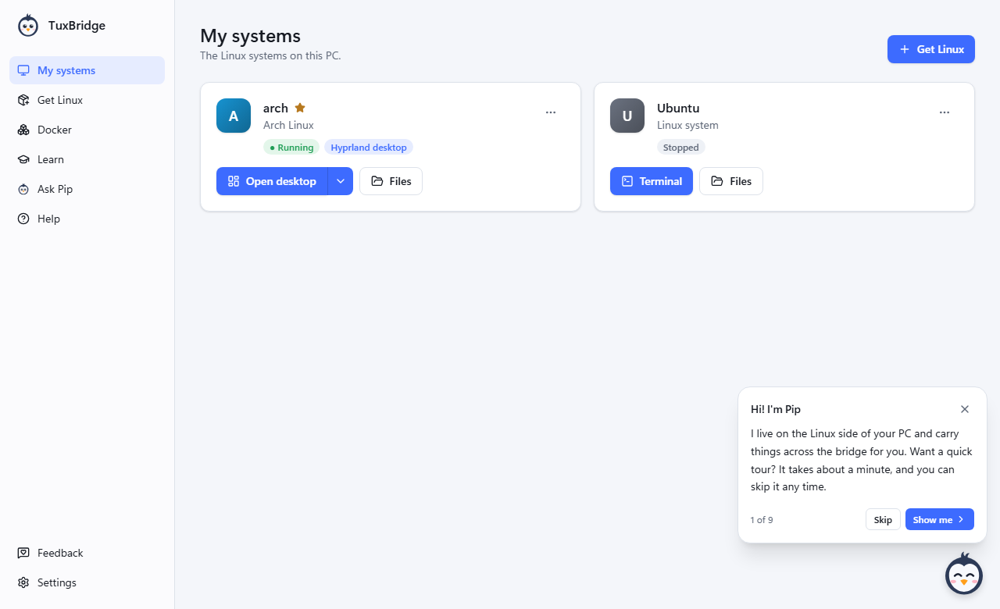

<div align="center">


# TuxBridge

**Linux on Windows, made easy.**

Install real Linux systems next to Windows, open full desktops in a window, run Docker apps in a click,
and learn as you go, with Pip the penguin to show you around.

[](https://tuxbridge.com/#download)
[](https://github.com/RookerySoftware/TuxBridge/releases)
[](LICENSE)


<picture>
  <source media="(prefers-color-scheme: dark)" srcset=".github/assets/screenshot-dark.png">
  
</picture>

</div>

## Why TuxBridge?

Windows already includes WSL, a way to run real Linux next to Windows. Getting from there to a
working Linux, though, usually takes an afternoon of tutorials. TuxBridge turns it into buttons,
written for people who have never used Linux or a command line, and stays useful once you know your
way around.

## Features

- **Checks your PC** for everything Linux needs (virtualization, WSL, Windows features) and fixes
  what it can, with one prompt from Windows.
- **Eight Linux systems** described in plain words: Ubuntu, Linux Mint, Debian, Arch Linux, CachyOS,
  Omarchy, Kali Linux and Parrot Security. Pick a name, an account and a desktop, and TuxBridge does
  the rest.
- **Full desktops in a window:** GNOME, Cinnamon, Xfce, KDE Plasma or Hyprland, drawn by
  TuxBridge's own fast display. No VNC, no network.
- **Docker in one click:** the free Docker Engine in a system of its own, a gallery of ready-made
  apps (media server, cloud storage, AI chat, databases), and `docker` from PowerShell and Linux.
- **Help without leaving the app:** about 50 guides, from "what is Linux" to networking and the GPU,
  with a search that understands operators like `"exact words"`, `-exclude` and `in:ubuntu`.
- **Learn by doing:** guided lessons, hands-on challenges in a real terminal, and a Kids mode.
- **Pip, your guide:** an optional companion with tips, a welcome tour, and a "Show me around" tour
  of every new system.
- **Ask Pip:** an optional AI assistant that runs on your own PC, so your questions never leave it.
- **Built-in feedback and updates:** report a problem from the app, and update TuxBridge from
  Settings with signed updates.

## Download

Get the latest version from **[tuxbridge.com](https://tuxbridge.com/#download)** or the
[releases page](https://github.com/RookerySoftware/TuxBridge/releases). The installer is free,
needs no administrator rights, and works on Windows 10 (21H2 or newer) and Windows 11 with
virtualization turned on.

> [!NOTE]
> TuxBridge is in pre-release. The installer isn't code-signed yet, so Windows SmartScreen may
> warn about it: choose **More info → Run anyway**. Updates from inside the app are signed and
> verified.

## Privacy

TuxBridge has no accounts and no tracking. Ask Pip runs entirely on your PC. The only thing sent
anywhere is what you choose to send from the Feedback page, and you can preview the diagnostic
report before it goes.

## Building from source

```powershell
pnpm install
pnpm tauri dev      # run it
pnpm tauri build    # make the installer
```

You'll need Rust, Node.js with pnpm, and Visual Studio's C++ build tools. See
[docs/development.md](docs/development.md) for the desktop display, tests, releasing, and a map of
the code. How the main parts work is described in [docs](docs/).

## Contributing

Bug reports, ideas and pull requests are welcome. The quickest way to report a problem is the
**Feedback** page in TuxBridge; for code, see [CONTRIBUTING.md](CONTRIBUTING.md). To report a
security issue privately, see [SECURITY.md](SECURITY.md).

## Acknowledgements

TuxBridge stands on great open-source work, including [Tauri](https://tauri.app),
[Hyprland](https://hyprland.org), [Omarchy](https://omarchy.org), the
[Docker Engine](https://docs.docker.com/engine/) (Moby), [Ollama](https://ollama.com) and every
Linux distribution it installs. The full list of libraries is in
[THIRD-PARTY-NOTICES.md](THIRD-PARTY-NOTICES.md).

## License

TuxBridge is open source under the [Apache License 2.0](LICENSE). Copyright 2026
[Rookery Software](https://rookerysoftware.app); see [NOTICE](NOTICE).

"TuxBridge", "Rookery Software" and Pip (the penguin's name and artwork) are trademarks of Rookery
Software and aren't covered by the license: forks need a name and logo of their own. Linux® is the
registered trademark of Linus Torvalds. Windows and WSL are trademarks of Microsoft. TuxBridge is
an independent project, not affiliated with Microsoft or any Linux distribution.
